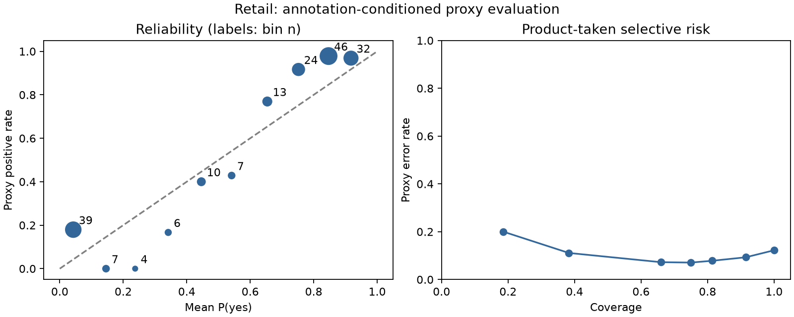

# Retail 결과 및 calibration — 261015_retail-demo-v2

대상: 188개 클립, 질문 6개. 저장된 응답을 오프라인으로 재계산했으며 모델 재호출·확률 보정 학습은 하지 않았다.

## 평가 범위

**아래 수치는 독립적인 정답 평가가 아니라 행동 주석과의 일치도 및 proxy calibration이다.**
`product_taken`의 대리 정답은 `count(take) > count(put)`이다. 주석이 없으면 음성으로 취급한다. 상품 식별·최종 소지·구매를 확인하는 정답은 아니다. take/put/touch 주석은 VLM 입력에도 제공되었다. 나머지 5개 질문과 직원 행동에는 독립적인 정답이 없어 정확도·ECE를 산출하지 않았다.

대리 양성 123 / 음성 65. 예측 기준 P(yes) ≥ 0.5.

| 지표 | Jev product_taken |
|---|---:|
| accuracy | 0.8777 |
| precision | 0.9098 |
| recall | 0.9024 |
| f1 | 0.9061 |
| brier | 0.1099 |
| nll | 0.4023 |
| ece | 0.1210 |
| mce | 0.2375 |
| confidence_ece | 0.0941 |

혼동행렬: TP=111, FP=11, FN=12, TN=54.

VLM-only 일치율: 0.8191 (188개 유효 응답). 항상 NO: 0.3457, 항상 YES: 0.6543.
VLM-only는 확률을 출력하지 않으므로 Brier/NLL/ECE를 계산하지 않았다. 답을 0/1 확률로 간주하지 않는다.

ECE = Σ (bin 표본 수 / N) × |평균 P(yes) − 양성 비율|. [0,1]을 동일 폭 10개 bin으로 나누며, 구간은 [하한, 상한), 마지막 구간만 1을 포함한다. MCE는 비어 있지 않은 bin의 최대 오차. Confidence ECE는 max(p,1−p)와 예측의 정답 여부를 비교한다. Brier는 평균 (p−y)², NLL은 자연로그 이진 log loss이며 로그 계산만 [1e−15,1−1e−15]로 clip한다. 낮을수록 좋다.

## Reliability bins

| P(yes) 구간 | n | 평균 확률 | 양성 비율 |
|---|---:|---:|---:|
| 0.0–0.1 | 39 | 0.0426 | 0.1795 |
| 0.1–0.2 | 7 | 0.1457 | 0.0000 |
| 0.2–0.3 | 4 | 0.2375 | 0.0000 |
| 0.3–0.4 | 6 | 0.3417 | 0.1667 |
| 0.4–0.5 | 10 | 0.4460 | 0.4000 |
| 0.5–0.6 | 7 | 0.5414 | 0.4286 |
| 0.6–0.7 | 13 | 0.6538 | 0.7692 |
| 0.7–0.8 | 24 | 0.7521 | 0.9167 |
| 0.8–0.9 | 46 | 0.8467 | 0.9783 |
| 0.9–1.0 | 32 | 0.9175 | 0.9688 |

## 확신 임계값별 coverage / risk

product_taken 한 질문에만 적용한 참고 분석이다. 전체 질문을 사용하는 MANAGER CHECK 정책과 다르며 임계값을 이 데이터에 맞춰 선택하지 않았다.

| 확신 기준 | 자동 판정 수 | Coverage | 대리 정답 오류율 |
|---|---:|---:|---:|
| 0.50 | 188 | 1.0000 | 0.1223 |
| 0.60 | 172 | 0.9149 | 0.0930 |
| 0.70 | 153 | 0.8138 | 0.0784 |
| 0.75 | 141 | 0.7500 | 0.0709 |
| 0.80 | 124 | 0.6596 | 0.0726 |
| 0.90 | 72 | 0.3830 | 0.1111 |
| 0.95 | 35 | 0.1862 | 0.2000 |
| 0.99 | 0 | 0.0000 | N/A |

## 주석 유무별 결과

| 그룹 | n | Accuracy | Brier | ECE |
|---|---:|---:|---:|---:|
| with_events | 153 | 0.8824 | 0.1133 | 0.1551 |
| without_events | 35 | 0.8571 | 0.0953 | 0.2263 |

## 속도·토큰

| 항목 | 중앙값 |
|---|---:|
| VLM-only | 1.501 s |
| VLM 관찰 | 2.762 s |
| Jev multi | 278.5 ms |
| VLM 관찰 + Jev (클립별 합의 중앙값) | 3.060 s |
| Jev single 병렬 요청 | 389.4 ms |
| Jev multi 토큰/클립 | 873.0 |
| Jev single 토큰/클립 | 2941.0 |

총 토큰: multi 164,177, single 553,394. API 단가 정보가 없어 금액으로 환산하지 않았다. 저장된 처리 시간으로 모델 로딩·전처리·렌더링은 제외한다. VLM state 재사용 시 관찰 시간은 최초 실행의 기록이다. Jev 시간은 성공한 요청의 기록이며 재시도 전체 시간이 아니다.

## 질문별 확신 비율 (정확도 아님)

| 질문 | 확신 비율 |
|---|---:|
| Shopper needs help? | 1.000 |
| Product taken? | 0.750 |
| Fridge door open? | 0.888 |
| Crowding | 0.995 |
| Shopper activity | 0.771 |
| Staff action | 0.059 |

## 직원 행동 분포

| 행동 | 클립 수 |
|---|---:|
| MANAGER CHECK | 83 |
| NO ACTION | 57 |
| CLOSE FRIDGE | 23 |
| OFFER HELP | 15 |
| KEEP WATCHING | 9 |
| RESTOCK CHECK | 1 |

## 해석 및 재현

확신이 높다는 사실만으로 확률이 보정되었다고 볼 수 없다. 이 결과는 선택된 test 클립의 기술 통계이며 전체 데이터셋·새 매장으로의 일반화나 직원 행동의 유효성을 입증하지 않는다. 주석 조건화, 대리 정답의 한계, 작은 bin 표본 수 및 클립 간 종속 가능성이 있다. 독립적으로 라벨링한 평가셋과 별도의 calibration split이 필요하다.

`uv run python scripts/evaluate_retail.py --run-dir runs/261015_retail-demo-v2 --output docs/retail-results`

`metrics.json`: 전체 지표·원본 SHA-256, `predictions.csv`: 클립별 대조값, `calibration.png`: reliability/risk 그림.
