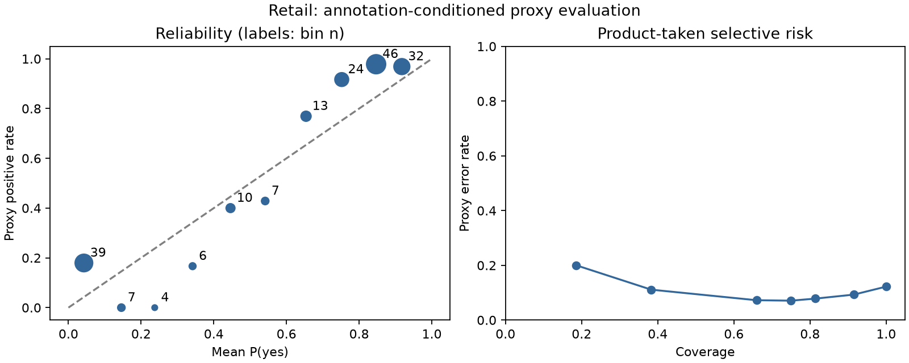

# RetailAction 실험 결과 요약

- 실행: `261015_retail-demo-v2` · 실행 시작 기록: 2026-10-15 06:29:15
- 기준 자료: [실행 설정](run.yaml), [원래 요약](evaluation/summary.json), 원본 VLM/Jev 응답 및 [재계산 지표](evaluation/calibration/metrics.json)
- 문서 작성 및 오프라인 재평가: 2026-10-19. 모델을 다시 호출하거나 확률 보정 모델을 학습하지 않았다.

188개 편의점 영상 클립에서 **VLM이 직접 답하는 경로**와 **VLM 관찰을 Jev가 판단하는 경로**를 비교했다. Jev 경로의 상품 취득 주석 일치율은 87.77%, VLM-only는 81.91%였다. Jev는 질문별 확률을 제공하고 6개 질문을 한 요청에 묶어 토큰을 절약했지만, 장면 관찰까지 포함한 처리 시간은 VLM-only보다 길었다.

**주석이 모델 입력에도 포함된 데모 평가다. 아래 일치율과 calibration은 독립적인 정답 평가가 아닌 대리 지표이며, 직원 행동의 적절성을 검증한 결과는 아니다.**

## 1. 데이터

| 항목 | 내용 |
|---|---|
| 데이터셋 | RetailAction, Standard AI의 편의점 천장 카메라 영상 |
| 사용 범위 | 선택 목록의 test split 188개 클립, rank0 카메라 뷰 |
| 클립 길이 | 실제 MP4 및 메타데이터 확인 결과 10–60프레임; 화면 재생 설정은 6 fps |
| 모델 입력 | 클립마다 시간순으로 균등 샘플링한 8프레임, 설정 `frame_px=448` |
| 행동 주석 | take 176건, put 32건, touch 8건; 한 클립에 여러 이벤트가 있을 수 있음 |
| 이벤트 유무 | 주석이 있는 클립 153개, 없는 클립 35개 |
| 회전 전처리 | 자세 키포인트의 엉덩이→머리 방향으로 90° 단위 회전. 139개 회전, 자세 축이 없는 8개는 회전하지 않음 |
| 개인정보·라이선스 | 얼굴은 데이터셋에서 블러 처리됨. [LICENSE](data/LICENSE), [NOTICE](data/NOTICE.txt) 참고 |
| 현재 데이터 위치 | 저장소 기준 `data/retailaction/`; 이 실행 폴더의 `data/`는 해당 자료를 링크함 |

행동의 시점과 위치를 입력 프레임의 원 표시 및 프롬프트로 제공했다. 이는 실제 행동 검출기의 출력을 대신하는 **데이터셋 주석**이며, VLM이 영상만 보고 행동을 검출한 실험은 아니다.

`product_taken` 평가의 대리 정답은 `count(take) > count(put)`이다. 양성은 123개, 음성은 65개다. 이벤트가 없는 클립도 음성으로 처리한다. 이 규칙은 상품의 동일성, 최종 소지 여부, 실제 구매를 확인하지 못한다.

> 기존 데모 설명의 “최대 32프레임” 대신, 이 문서는 현재 실행에서 참조하는 188개 MP4와 메타데이터의 실제 프레임 수를 사용했다.

## 2. 실험 비교

### 2.1 VLM-only와 VLM + Jev

| 항목 | VLM-only | VLM + Jev |
|---|---|---|
| 시각 모델 | Qwen/Qwen3-VL-8B-Instruct | 동일 모델 |
| 입력 | 회전된 8프레임 + 알려진 행동 주석 | 동일 조건 |
| VLM의 역할 | 질문 6개에 직접 답변 | 판단 없이 관찰한 장면을 STATE JSON으로 기술 |
| 후속 판단 | 없음 | Jev가 STATE를 읽고 질문 6개에 답변 |
| 답변 형식 | Boolean·선택지 등 값만 출력 | 답변과 질문별 확률 |
| 확신 기반 보류 | 확률이 없어 적용하지 않음 | 주요 질문의 확신이 낮으면 MANAGER CHECK |
| 비교 목적 | 직접 답변 기준선 | 관찰·판단 분리 및 확률 활용 |

VLM 설정은 `bfloat16`, `cuda:0`이며 생성 토큰 상한은 장면 관찰 320, 직접 답변 200이다. Jev 요청 모델명은 `jev-latest`였고, 저장된 응답의 실제 모델은 **`jev-1.13.0`**이다.

이 실행은 `reuse_states_from=runs/261015_retail-demo`로 앞선 실행의 VLM 관찰 STATE를 재사용했다. 따라서 관찰 시간은 최초 생성 기록이며, 이번 실행에서 모두 다시 측정한 시간이 아니다.

### 2.2 Jev multi와 single

- **Multi**: 같은 STATE와 6개 질문을 요청 1번으로 전송한다. 실제 행동 결정은 이 응답을 사용한다.
- **Single**: 같은 STATE에 질문을 하나씩 넣어 요청 6번을 **동시에** 보낸다. 요청 수·토큰·벽시계 시간 비교용이다.
- 아래 Single 시간은 순차 요청 6회의 합이 아니다. 이 요약에서는 Multi와 Single의 답변 품질 동등성을 검증하지 않았다.

### 2.3 공통 질문

| 키 | 질문 | 형식 |
|---|---|---|
| `needs_help` | 손님에게 직원 도움이 필요한가? | Boolean / Noul |
| `product_taken` | 상품을 집고 돌려놓지 않아 최종적으로 가져갔는가? | Boolean / Noul |
| `fridge_open` | 냉장고 문이 열려 있는가? | Boolean / Noul |
| `crowding` | 얼마나 혼잡한가? | Score, 5단계 |
| `shopper_activity` | 손님의 주요 행동은 무엇인가? | Choice, 5개 선택지 |
| `staff_action` | 직원이 다음에 해야 할 일은 무엇인가? | Choice, 6개 선택지 |

## 3. 사용하는 코드 및 파이프라인

아래 경로는 현재 정리된 코드 기준이다. 실행 당시에는 `scripts/*_retail_demo.py`, `src/jevgate/demo/` 경로를 사용했다.

```text
RetailAction 클립 + 자세/행동 주석
  → 자세 축으로 회전 결정, 이벤트 메타데이터 준비
  → 회전된 RGB 영상에서 8프레임 선택 + 행동 표시/프롬프트
      ├─ VLM-only: 질문 6개에 직접 답변 → 공통 행동 규칙
      └─ VLM 관찰 STATE (이 실행은 이전 결과 재사용)
          → Jev Multi: 질문 6개를 한 번에 판단 → 확률 카드 → 행동 규칙
          └─ Jev Single: 질문별 병렬 요청 → 시간·토큰 비교
  → 저장된 응답으로 요약·calibration 평가
  → 대시보드 MP4 및 클립별 스틸
```

| 단계 | 실행 코드 / 핵심 모듈 | 주요 입력·출력 |
|---|---|---|
| 전처리 | [prepare_retail.py](../../scripts/prepare_retail.py), `preprocess/metadata.py`, `preprocess/frames.py` | selection/samples/frames JSON → `data/meta.jsonl` |
| 전체 실행 | [run_retail.py](../../scripts/run_retail.py), [pipeline.py](../../src/jevgate/pipeline.py) | 설정을 읽고 관찰·판단·평가·렌더링 조율 |
| VLM 관찰·직접 답변 | [models/observer.py](../../src/jevgate/models/observer.py) | 클립·이벤트 → `vlm/output/states.jsonl`, `vlm_only/output/answers.jsonl` |
| Jev 요청·판단 | [decision/policy.py](../../src/jevgate/decision/policy.py), `models/jev.py` | STATE → `jev/input/requests.jsonl`, `jev/output/{responses,decisions,single}.jsonl` |
| 행동 결정 | `decision/policy.py::action` | 질문 카드 → `actions/actions.jsonl` |
| 오프라인 평가 | [evaluate_retail.py](../../scripts/evaluate_retail.py), `evaluation/metrics.py`, `evaluation/report.py` | 저장된 응답·주석 → `evaluation/calibration/` |
| 시각화 | [render_retail.py](../../scripts/render_retail.py), `visualization/dashboard.py`, `visualization/video.py` | 클립·STATE·판단 → `evaluation/dashboard.mp4`, `evaluation/stills/` |

행동은 다음 순서에서 **처음 만족하는 규칙**으로 결정한다.

1. `P(fridge_open=yes) ≥ 0.75` → **CLOSE FRIDGE**.
2. `P(needs_help=yes) ≥ 0.75` → **OFFER HELP**.
3. `staff_action`을 제외한 주요 질문 5개 중 하나라도 최고 확률이 0.75 미만 → **MANAGER CHECK**.
4. 나머지는 `staff_action`의 선택값을 행동 배지로 변환한다.

따라서 불확실한 질문이 있어도 1·2번 규칙이 먼저 만족되면 해당 행동이 선택된다. `staff_action` 자체의 낮은 확신은 MANAGER CHECK 조건에 포함되지 않는다. 여기서 행동은 화면 배지 출력이며 실제 직원 호출이나 장치 제어가 아니다.

## 4. 결과 정리

### 4.1 상품 취득 주석과의 일치도

| 비교 경로 | 대리 정답 일치율 |
|---|---:|
| VLM + Jev Multi | **87.77% (165/188)** |
| VLM-only | 81.91% (154/188) |
| 항상 YES 기준선 | 65.43% (123/188) |
| 항상 NO 기준선 | 34.57% (65/188) |

Jev 경로가 VLM-only보다 **5.85%p** 높았다. 이는 이 선택 표본의 관측 차이이며 통계적 유의성이나 새 매장에서의 우월성을 입증하지 않는다. Jev의 precision은 90.98%, recall은 90.24%, F1은 0.9061이다. 혼동행렬은 TP 111, FP 11, FN 12, TN 54다.

### 4.2 Calibration

보정 모델을 학습한 결과가 아니라 **원래 Jev 확률의 calibration을 측정한 결과**다.

| 지표 | 값 | 의미 |
|---|---:|---|
| Brier score | 0.1099 | 평균 `(p−y)²` |
| NLL | 0.4023 | 자연로그 기반 이진 log loss |
| ECE | 0.1210 | P(yes)의 구간별 평균 확률과 양성 비율 차이를 표본 수로 가중 평균 |
| MCE | 0.2375 | 비어 있지 않은 확률 구간의 최대 calibration 차이 |
| Confidence ECE | 0.0941 | `max(p,1−p)`와 예측 정답 여부의 구간별 차이 |

모두 낮을수록 좋다. ECE는 [0,1]을 같은 폭의 10개 bin으로 나눈다. 빈 bin은 가중치가 0이며 마지막 구간에 p=1을 포함한다. VLM-only는 확률을 출력하지 않으므로 Brier/NLL/ECE를 산출하지 않았다. 나머지 질문 5개에는 독립적인 정답이 없어 calibration을 평가하지 않았다.



### 4.3 확신 기준과 자동 판정 범위

`product_taken` 한 질문만 대상으로 `max(p,1−p) ≥ 기준`인 클립을 자동 판정한다고 가정한 분석이다. 전체 질문을 사용하는 실제 MANAGER CHECK 정책과는 다르다.

| 확신 기준 | 자동 판정 수 | Coverage | 자동 판정 내 대리 정답 오류율 |
|---|---:|---:|---:|
| 0.50 | 188 | 100.00% | 12.23% |
| 0.75 | 141 | 75.00% | 7.09% |
| 0.90 | 72 | 38.30% | 11.11% |
| 0.95 | 35 | 18.62% | 20.00% |

확신 기준을 높여도 오류율이 계속 감소하지 않는다. 따라서 “높은 확률이면 안전하게 자동 처리 가능”하다고 결론 내릴 수 없다. 별도 검증셋으로 임계값을 정하고 독립 라벨로 확인해야 한다.

### 4.4 시간·요청·토큰

| 항목 | 클립당 중앙값 |
|---|---:|
| VLM-only 직접 답변 | **1.501 s** |
| VLM 장면 관찰 | 2.762 s |
| Jev Multi 판단만 | 278.5 ms, p90 361.49 ms |
| VLM 관찰 + Jev Multi | **3.060 s** |
| Jev Single 6개 병렬 요청의 벽시계 시간 | 389.4 ms |
| Jev Multi 토큰 | 873 |
| Jev Single 토큰 | 2,941 |

- Multi는 클립당 요청 6개를 1개로 줄인다. 188개 클립의 논리적 요청 수는 Multi 188개, Single 1,128개다. 재시도 횟수는 포함하지 않는다.
- 전체 토큰은 Multi **164,177**, Single **553,394**로 Multi가 약 **70.3% 절감**했다.
- 3.060초는 클립별 관찰 시간과 Jev 시간을 합한 뒤 구한 중앙값이다. 각 중앙값을 단순히 더한 값과 구분한다.
- Jev 단독 판단은 빠르지만, 장면 관찰을 포함하면 직접 답변 경로보다 느리다. VLM 관찰 STATE가 이미 필요한 시스템에서는 Jev의 추가 판단 비용을 별도로 볼 수 있다.
- 모델 로딩·전처리·렌더링은 시간 비교에서 제외한다. Jev 시간은 성공한 요청의 기록이며 전체 재시도 대기 시간이 아니다. 단가가 없어 금액으로 환산하지 않았다.

### 4.5 질문별 확신과 최종 행동

| 질문 | 최고 확률 ≥ 0.75인 비율 |
|---|---:|
| 도움 필요 | 100.0% |
| 상품 취득 | 75.0% |
| 냉장고 문 열림 | 88.8% |
| 혼잡도 | 99.5% |
| 손님 행동 | 77.1% |
| 직원 행동 | 5.9% |

위 비율은 **정확도가 아니다**. 특히 직원 행동은 확신 기준을 넘는 비율이 낮지만, 현재 정책은 이 질문을 보류 조건에서 제외한다.

| 최종 행동 | VLM + Jev | VLM-only |
|---|---:|---:|
| MANAGER CHECK | 83 | 0 |
| NO ACTION | 57 | 173 |
| CLOSE FRIDGE | 23 | 15 |
| OFFER HELP | 15 | 0 |
| KEEP WATCHING | 9 | 0 |
| RESTOCK CHECK | 1 | 0 |
| 합계 | 188 | 188 |

Jev 경로의 MANAGER CHECK 비율은 **44.15%**이고 두 경로의 최종 행동 일치율은 **36.2%**다. 보류 기능의 유무가 다르므로 행동 분포 차이를 품질 차이로 해석할 수 없다. 관찰 STATE의 JSON 파싱 실패와 VLM-only의 허용값 위반은 각각 0건으로 기록됐다.

### 4.6 산출물 및 재현 범위

- [대시보드 영상](evaluation/dashboard.mp4): 전체 188개 평가 중 선택한 7개 클립을 표시한다.
- [스틸 이미지](evaluation/stills/): 001404, 002429, 002491, 000421, 000134, 000951, 000953.
- [Calibration 상세 보고서](evaluation/calibration/report.md), [전체 지표 JSON](evaluation/calibration/metrics.json), [클립별 CSV](evaluation/calibration/predictions.csv).
- [원본 Jev 응답](jev/output/responses.jsonl), [행동 결과](actions/actions.jsonl).

저장소 루트에서 다음 명령으로 원본 응답을 다시 평가할 수 있다. GPU나 API 호출이 필요하지 않다.

```bash
uv run python scripts/evaluate_retail.py --run-dir runs/261015_retail-demo-v2
```

실행 기록의 커밋은 `33c1711`, 브랜치는 `feat/retail-demo`, `dirty: true`다. 따라서 커밋 하나만으로 실행 당시 코드를 완전히 재현할 수 있다고 보장할 수 없다. 저장된 `run.yaml`의 렌더 설정은 최대 24개 클립이지만 현재 산출물은 7개 스틸이며, 이후 렌더링 설정으로 다시 생성된 결과와 구분해야 한다.

2026-10-19 문서 작성 시 데이터 이동으로 끊어진 이 실행의 `data/` 링크 4개를 현재 위치로 복구했다. 메타데이터 SHA-256이 이전 평가 기록과 동일함을 확인했으며, 실행 당시 설정과 원본 응답은 수정하지 않았다.
